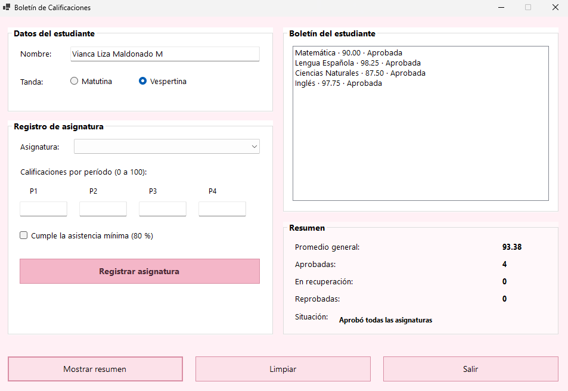

Vianca Liza Maldonado Mejia
Matricula 2025-3294

# Boletín de Calificaciones

Aplicación de escritorio de Windows Forms en C# para registrar las calificaciones de un estudiante, calcular promedios y mostrar su situación académica.

## Objetivo

Aplicar controles básicos de Windows Forms, validaciones y condicionales para gestionar las calificaciones de cinco asignaturas: Matemática, Lengua Española, Ciencias Naturales, Inglés e Informática.

## Funcionalidades

- Ingresar el nombre del estudiante y seleccionar su tanda.
- Elegir una asignatura e ingresar sus calificaciones de cuatro períodos.
- Indicar si el estudiante cumple la asistencia mínima.
- Registrar cada asignatura con su promedio y situación en una lista.
- Mostrar el promedio general, los conteos por situación y la situación general.
- Limpiar el formulario o cerrar la aplicación.

## Reglas de cálculo

- Cada calificación debe estar entre 0 y 100.
- El promedio de una asignatura es la suma de las cuatro calificaciones dividida entre 4.
- Con asistencia mínima de 80 %:
  - **Aprobada:** promedio igual o superior a 70.
  - **En recuperación:** promedio desde 60 hasta menos de 70.
  - **Reprobada:** promedio menor de 60.
- Sin asistencia mínima, la asignatura queda **reprobada por asistencia**, sin importar el promedio.
- El promedio general es el promedio de los promedios de las asignaturas registradas.
- La situación general indica si aprobó todas las asignaturas, si tiene asignaturas en recuperación (sin reprobadas) o si tiene asignaturas reprobadas.

## Uso

1. Escribe el nombre del estudiante y selecciona la tanda.
2. Selecciona una asignatura, ingresa las cuatro calificaciones e indica si cumple la asistencia mínima.
3. Pulsa **Registrar** para agregar la asignatura a la lista.
4. Repite el proceso para cada asignatura que quieras registrar.
5. Pulsa **Mostrar resumen** para consultar los resultados.
6. Usa **Limpiar** para volver al estado inicial o **Salir** para cerrar el programa.

La aplicación debe validar que el nombre no esté vacío, que se haya seleccionado la tanda y la asignatura, que las cuatro calificaciones sean números válidos dentro del rango permitido y que exista al menos una asignatura antes de mostrar el resumen. Los avisos se presentan mediante cuadros de mensaje.

## Interfaz

El formulario organiza los controles de entrada, registro y resumen en grupos. Los nombres de controles siguen los prefijos indicados en la actividad: `txt`, `rdb`, `cmb`, `chk`, `lst`, `lbl` y `btn`.

## Requisitos y restricciones

- Proyecto Windows Forms en C#.
- La lógica del programa debe estar en `Form1.cs`, sin clases adicionales.
- Usar constantes para los umbrales 70 y 60 y para la cantidad de períodos (4), evitando repetir esos valores como números fijos.
- Comentar cada evento.
- No usar `DataGridView`, bases de datos, archivos, librerías externas ni `Console`.
- El proyecto debe ejecutarse sin errores.

## Ejecución

Abre el archivo de solución del proyecto (`.sln`) en Visual Studio y ejecuta la aplicación. El proyecto debe estar configurado como Windows Forms para la versión de .NET instalada en el equipo.

## Captura

